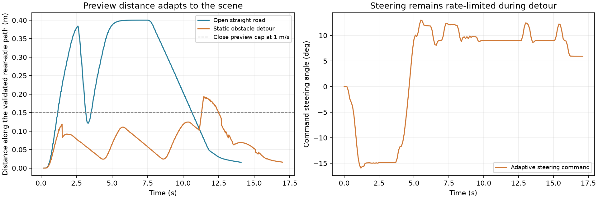

# 自适应转向预瞄更新

当前源码已实现“近障碍/急弯缩短预瞄，开阔且平滑路段放大预瞄”。当前控制器是几何投影 LQR，转向前馈可以查询前方路径曲率；横向/航向误差始终在当前后轴投影处计算。没有用远处目标的航向替换当前误差，也没有另造一条直线切过已经验证的绕障路径。

## 两个不同的预瞄量

- 转向曲率预瞄：这次改为自适应。参考点始终在规划器已验证的后轴路径上。
- 速度预瞄：speed_preview_distance仍为0.25m，用于查询规划速度参考，本次没有把它当成转向前瞻距离。

所有预瞄距离都从**当前后轴路径投影**沿路径里程计算；/localization仍是车体几何中心。它们不是纯追踪控制器中“车头到目标点”的同一个参数。

## 当前规则和参数

| 条件/参数 | 当前值 |
| --- | --- |
| 开阔、平滑路段目标距离 | min(0.5m, 0.4s × 测得的前进速度) |
| 近障碍/急弯目标距离 | min(0.15m, 0.15s × 测得的前进速度) |
| 本车最高1.0m/s时的典型距离 | 开阔约0.4m；近障碍不超过0.15m |
| 净空风险区间 | 0.35–1.5m，独立于0.12m碰撞安全裕度 |
| 路径曲率风险区间 | 0.2–0.6 /m |
| 前方曲率变化风险区间 | 0.15–0.5 /m |
| 风险扫描范围 | 最多0.8m有效路径，13个采样 |
| 风险刷新 | 新路径/新障碍输入或间隔0.1s；距离每个控制周期更新 |
| 缩短/恢复 | 高风险立即施加短距离上限；离险保持0.6s，再按0.3m/s扩大 |
| 输出转向限制 | 保留30°/s、100°/s²约束及最终碰撞检查 |

判据同时考虑前方曲率峰值、曲率变化和真实矩形净空。无障碍但曲率很大或出现S弯反向时，也采用短预瞄；远处或身后的无关障碍不会简单触发短预瞄。计算量采用保守相关性筛选，最多详细评估12个风险相关对象；若相关对象更多则用短预瞄。最终执行碰撞检查仍使用完整障碍列表。

风险达到0.75进入短预瞄，保持时间过后且风险低于0.55才退出，避免在边界来回切换。停车时预瞄距离立即归零，距离也不超过剩余有效路径长度。

如果需要同实车日志做固定/自适应对照，可在YAML中将adaptive_preview_enabled设置为0.0并重启节点恢复原preview_time=0.15s固定转向预瞄；1.0启用新规则。旧lookahead_base等兼容参数不驱动这套LQR预瞄，实际参数以preview_open_*、preview_close_*为准。

## 日志

/rda/control_diag的tracking.preview记录：

- 实际及目标预瞄距离、短预瞄锁存和立即上限标记。
- 原因：开阔平滑、障碍净空、路径曲率、曲率变化、释放保持、感知不新鲜或复杂场景。
- 曲率峰值/变化、预测净空、相关障碍数量、风险数据年龄与计算耗时。
- 预瞄点的后轴路径坐标、航向与曲率。

这些内容自动进入前一版新增的逐消息日志；快照也保留tk_preview字段。速度预瞄距离另有speed_preview_distance_m，避免事后误把0.25m解释成转向预瞄。

## 离线验证

比较了固定预瞄及5组自适应候选，各11个静态/动态、无障碍平滑弯道、3Hz和厘米噪声条件，共66次参数比较。候选按碰撞、未到达、自转次数、转角累计变化和时间排序；相同表现时选择较保守的开阔预瞄。选定0.4s/0.15s组合在11个条件中全部到达、无碰撞。过短的0.08s组合转角累计变化较多，预瞄并非越短越好。

最后运行23个场景的固定/自适应对照，共46次，以及21个扩展条件：

- 20个常规5–8m场景和1个近侧向回归均到达。
- 17个应可通过的低频、噪声、延迟扩展均到达。
- 无可行自转、无模式回显、持续规划超时保持安全停车；窄路非协作会车仍保留碰撞失败。
- 空场8m直行稳速时预瞄约0.4m；静态单障碍的短预瞄阶段实际不超过约0.125m，随车速变化。
- 单静态障碍最大命令转角约15.9°、净空约0.265m，连续绕行、不自转。大多数当前DWA轨迹近似常曲率，转角前馈对不同预瞄点相近，因此多数对照工况轨迹接近。
- 不保证所有转角更小或更平滑：两静态障碍场景转角累计变化约79.7→84.0°；一个2cm噪声、低更新率且较大输入延迟的行人场景约23.7s到达，比前一版慢。完整结果均保留，不能只用挑选的有利样例判断。

54项Python回归通过，包含新增的12项预瞄规则测试及之前算法/日志的42项回归。没有启动ROS、DDS、UDP或实车；原始感知、真实制动/舵机延迟及车机运行开销仍须用实测日志确认。



图中开阔直行的距离随速度变化；约3s的短暂下降来自仿真中一次规划结果过期造成的减速，不代表检测到了障碍。原因和速度可在逐消息诊断中核对。

## 部署与回滚

完整更新包deployment_20261107_adaptive_preview.zip包含前面算法修改、日志升级和本次自适应预瞄；当前源码已更新。已有上一版的车机重点重新构建rda_dwa_real并source。由最初版本整体升级时，还须构建此前改动的消息包、common和car_ctr。

```bash
# 在车机ROS工作空间根目录
colcon build --packages-up-to rda_dwa_real
source install/setup.bash
```

preview_changes.patch是本次单独补丁。rollback_preview.py撤销本次更新并保留之前算法与日志版本；rollback.py恢复最初源码。脚本默认只检查，加--apply才修改，并拒绝覆盖后续编辑。apply_delivery.py可检查并将完整更新覆盖到匹配的既有源码树。

复现当前对照/扩展：final_compare.py、extended_validate.py。parameter_search.json记录候选和全部结果；final_comparison.json、extended_results.json及各场景轨迹/预瞄JSON保存最终数据。
