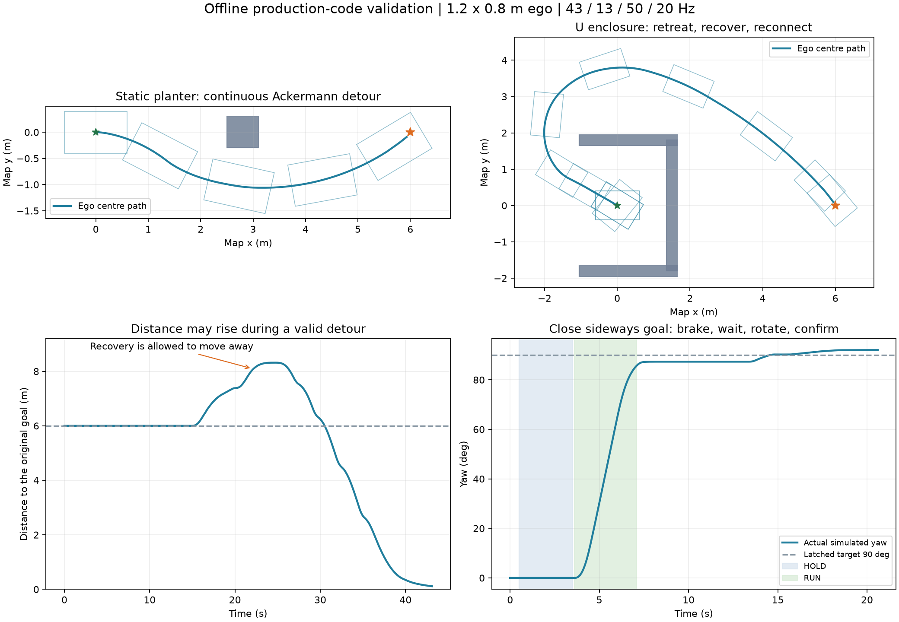

# 两项工作的合并交付：模式切换、trap、学校静动态避障

代码已在当前 src_doubao 源码中修改。本交付包含第一阶段的大转角/时序修复与第二阶段的模式/trap/学校工况改进。第一阶段压缩包仍保留原样；本目录 deployment_20261107_combined.zip 才是最终合并版本。

这是运行生产 Python 核心及实际 C++ 源码替身的离线闭环测试。未启动实车、ROS/DDS 或 UDP。当前电脑没有 ROS/colcon，因此没有做 ROS 构建、原始点云端到端测试或实车参数标定。

## 原实车问题的原因与对应修复

原日志与完整证据见 [原日志分析](../../analysis/20261107_real_logs/analysis_report.md)。record_data.zip 中共有 4 次独立实验；222.zip 与其中最后一次相同，不应算作另一份独立实验。

- 跟踪器原先按墙钟时间查询未来参考，即使车没有前进，参考航向仍向前推进。原日志中存在规划 +11.87°、命令 +28.65°；规划 +8.41°、命令 −28.49°；规划 +2.48°、命令 +30°。新跟踪器按实际几何投影计算误差，完整替换已验证的路径，避免旧路径末尾与新路径接缝生成超过物理曲率的参考。固定姿态 κ=.3/m 回归保持在约 11.7°，不会随等待变成 30°。
- 原模式判据把经过截断的 dt 用于等待/失败计时，规划长耗时又阻塞发布，导致近目标迟迟不能触发自转；自转目标还可能受 APF 排斥反向偏移。原 222 日志从首次目标至首次自转请求约 76.8 s，其中第二次目标后仍等约 20 s。改为独立异步规划和主节点实时仲裁，自转目标锁存为可行引导方向，不再用 APF 方向替换近目标角度。
- 执行流程现在为 ACK 刹停 → 连续停车确认 → 请求轮模式 4 → 新模式回显及至少 3 s 机械等待 → 自转 → 刹停并复核最终角度 → 请求 ACK 及机械等待。自转执行超时 10 s；同会话修正不重新获得 10 s 预算。旧会话结果不能完成新会话。若在尚未切轮的刹停阶段取消，已有 ACK 回显可以证明轮模式未改变，避免等待一个本不会产生的新回显。

## 当前模式与 trap 逻辑

5–8 m 侧向目标先使用可行的连续 Ackermann 轨迹；近目标距离 <3.5 m 且引导航向误差 >75° 才走直接自转分支。长期方向停滞或静态阻塞持续 1.5 s 后，可进入有安全检查的恢复。实际运动停滞采用约 3 s 内未累计移开 0.12 m 的窗口；定位噪声不会作为“靠近终点失败”输入。

恢复使用锁存的世界坐标子目标，默认 1.8 m。候选方向同时检查真实矩形的旋转扫掠和之后的前进轨迹，考虑动态障碍与机械返回等待。无法找到安全方向时停车并明确报告失败。单次恢复最多 2 次请求，同一原目标总共最多 4 次；走了 0.6 m 或绕了一圈不会自动清零。只有接回原引导、验证可行且沿固定局部方向取得至少 0.4 m 实际进展后，才重置本次恢复计数；原目标总次数仍保留。

**原终点距离暂时增加从来不是失败条件。** 静态引导的拐点一旦经过，就持续向下一段推进，避免反复重新选择身后的拐点。动态让行通过“完整障碍检查失败、仅静态障碍检查仍可运动”的反事实检查识别；远处存在行人不会一律禁止恢复。动态让行、计算/输入错误以及轮模式返回等待冻结恢复计时。旧 spin_reset_progress / trap_exit_ratio 等兼容参数不再驱动这套恢复流程。

## 尺寸、速度与感知

| 内容 | 当前值或行为 |
| --- | --- |
| 本车物理矩形 | 1.2 × 0.8 m |
| 轴距 | 0.69 m |
| /localization 参考 | 车体几何中心；后轴转换仅在内部 |
| 转向上限 | 30° |
| 本车硬速度上限、巡航目标 | 1.0 m/s；受转弯/障碍/终点限速 |
| 安全裕度 | 0.12 m，独立于真实车尺寸 |
| 仿真行人 | 0.4 / 0.6 m/s，0.4 × 0.4 m |
| 仿真普通乘用车 | 0.8 / 1.0 m/s，4.5 × 1.8 m |
| 仿真机器人车 | 0.8 / 1.0 m/s，1.2 × 0.8 m |
| 点云检测范围 | 周围 6 m，保留侧方和后方；不再仅检测前方 |

碰撞判定使用实际矩形 OBB/SAT。圆半径只作为快速排除或采样间运动上界，不会再把圆形外包矩形当作车身尺寸。后轴位置目前按前后轴相对几何中心对称处理，即中心向后 0.345 m；若实车前后悬不对称，仍需测量后轴至定位中心距离并修改该转换。

点云采用 0.08 m 体素内极值保留及空间哈希连通聚类，避免长车表面因簇质心移动被碎分。8000 点以上的聚类输入不会被伪装成空场景；该帧停止更新，下游按超时停车。聚类微基准 1000 / 4000 / 8000 点约 2.2 / 15.9 / 38.9 ms，未包含实际 PointCloud2 解析、全 KF 或车机耗时。

新增 Obstacle.has_shape_heading / shape_heading，把矩形朝向与速度方向分开。停放汽车的旋转矩形和行驶汽车的尺寸可保留；最新检测框也会围绕滤波后的中心保守扩展。未知或短时丢失目标保留未知运动包络，避免直接变为空场景。尺寸分类依然是几何启发式；局部/遮挡点云不会自动补成完整 4.5 × 1.8 m 汽车，这也是实车验证的重要边界。

## 参数选择与频率

先比较 8 个候选组合，各跑 8 个 13 Hz 障碍更新场景；再对每个候选补跑 4 个 3 Hz、1–2 cm 定位噪声、最高 150 ms 结果延迟场景，共 **96 次**。另比较 0.5 / 0.8 / 1.0 s 停车观察窗口，各 4 次，共 **12 次**。总计 108 次参数比较。

候选按碰撞次数、未到达次数、模式请求次数、转角累计变化量、总时间依次排序。下表每行是 12 个条件的合计；它是有限候选中的排序，不是全局最优证明。

| 候选 | 碰撞 | 未到达 | 自转请求 | 转角总变化° | 总时间s |
| --- | --- | --- | --- | --- | --- |
| foundation_school | 0 | 0 | 4 | 1591.3 | 330.05 |
| wide_guide | 0 | 0 | 4 | 1519.6 | 320.12 |
| cruise08 | 0 | 0 | 5 | 1740.7 | 338.23 |
| wide_preview | 0 | 0 | 4 | 1517.6 | 313.49 |
| quick_recovery | 0 | 1 | 7 | 1663.1 | 360.64 |
| patient_recovery | 0 | 0 | 4 | 1574.7 | 347.26 |
| lateral045 | 0 | 0 | 4 | 1564.9 | 322.61 |
| balanced | 0 | 0 | 4 | 1538.1 | 319.13 |

最终选择 **wide_preview**，12/12 到达、无碰撞。仅在高更新率下占优的 quick_recovery 在低频扩展出现失败，未选用。

| 活跃参数 | 最终值 |
| --- | --- |
| LQR Q_y / Q_heading / R | 8 / 2 / 4 |
| steer_weight / steer_change_weight | 0.4 / 0.12 |
| guide_extra | 0.12 m（引导启发式额外净空，车身仍为物理尺寸） |
| speed_preview_distance / preview_time | 0.25 m / 0.15 s |
| lateral_acc_max | 0.6 m/s² 的速度目标限制 |
| max_steer_rate / max_steer_accel | 30°/s / 100°/s² |
| feedback_limit | 8° |
| acc / dec / jerk | 0.7 / 1.2 m/s²，2.0 m/s³ |
| stop_window_s / spin_stop_speed | 1.0 s / 0.035 m/s |
| spin_w_max / spin_acc | 0.6 rad/s / 0.8 rad/s² |
| spin_wait_time / spin_timeout | 3.0 s / 10.0 s |
| blocked_spin_time / motion_stall_time | 1.5 s / 3.0 s |
| recovery_subgoal_distance / retries | 1.8 m / 每次 2 次，每原目标总共 4 次 |
| trap_max_duration | 每个恢复子目标 45 s 有效执行预算，故障和等待暂停计时 |
| goal_replay_epsilon | 0.05 m；同目标重复发布不重新清空状态 |
| planning_budget / result_max_age | 80 / 300 ms |

日志频率见 recorded_frequency_profiles.json：定位约 43–44 Hz，car_cmd/跟踪约 50 Hz，C++ 驱动实际 20 Hz，障碍约 12–14.5 Hz，222 约 3 Hz；规划间隔最长 3.51 / 4.91 / 6.74 / 10.65 s；car_state 大多只有偶发模式回显，不能假设连续轮速反馈。

仿真分别运行物理模型 200 Hz、定位 43 Hz、跟踪 50 Hz、驱动 20 Hz、主监督 10 Hz、障碍 13/3 Hz，源时间与到达延迟分别建模。C++ /car_cmd 队列由 10 改为 1，驱动每轮使用最新命令。离线延迟器模拟异步结果；真实 spawned worker 另用回归测试确认不阻塞和拒收超时结果。

将四组日志的原规划到达序列直接用于新监督的到达时序测试，结果为 2 次到达、2 次因后续长期没有新结果而停车，均无碰撞和 trap 请求。没有将旧 0–0.5 Hz 到达率伪装成 10 Hz 规划成功；主监督的 10 Hz 心跳并不保证每次都有可用规划。

## 最终闭环结果

共 21 个标准/负例测试：18 个常规 5–8 m 条件和 1 个近侧向回归均到达；另有 1 个无法自转的安全停车、1 个窄路非协作汽车撞向已停车本车的碰撞失败。没有把负例排除后宣称“全场景零碰撞”。

| 场景 | 结果 | 时间s | 最小真实净空m | 最大命令转角° | 自转请求 |
| --- | --- | --- | --- | --- | --- |
| 空场直行 5 m | 到达 | 11.71 | — | 0.0 | 0 |
| 空场直行 8 m | 到达 | 14.21 | — | 0.0 | 0 |
| 侧向 5 m | 到达 | 13.01 | — | 25.8 | 0 |
| 后方 6 m | 到达 | 27.82 | — | 4.1 | 1 |
| 单静态障碍 6 m | 到达 | 17.11 | 0.264 | 15.9 | 0 |
| 两静态障碍 8 m | 到达 | 18.32 | 0.264 | 15.9 | 0 |
| 停放普通汽车 8 m | 到达 | 40.71 | 0.502 | 28.1 | 1 |
| 横墙绕行 7 m | 到达 | 18.41 | 0.351 | 28.8 | 0 |
| U 形退出 6 m | 到达 | 43.11 | 0.426 | 26.2 | 1 |
| 行人横穿 0.4 m/s | 到达 | 17.71 | 0.252 | 10.5 | 0 |
| 行人横穿 0.6 m/s | 到达 | 15.01 | 0.287 | 19.0 | 0 |
| 机器人车横穿 0.8 m/s | 到达 | 15.81 | 0.268 | 12.6 | 0 |
| 机器人车横穿 1.0 m/s | 到达 | 16.02 | 0.303 | 22.4 | 0 |
| 普通汽车横穿 0.8 m/s | 到达 | 24.82 | 0.283 | 30.0 | 0 |
| 普通汽车横穿 1.0 m/s | 到达 | 19.52 | 0.290 | 19.8 | 0 |
| 跟随普通汽车 0.8 m/s | 到达 | 14.21 | 1.354 | 0.0 | 0 |
| 宽路会车 1.0 m/s | 到达 | 14.21 | 0.800 | 0.0 | 0 |
| 静障 + 远处行人 | 到达 | 17.11 | 0.264 | 15.9 | 0 |
| 近侧向 2.5 m 回归 | 到达 | 20.61 | — | 4.0 | 1 |
| 窄处无法自转 | 安全停车，未到达 | 1.60 | 0.200 | 0.0 | 0 |
| 窄路非协作会车 | 碰撞失败 | 7.25 | 0.000 | 0.0 | 0 |

- 普通单障碍：最大命令转角约 15.9°，不自转，净空约 0.264 m。原日志中的命令为实车不同工况，不能用这两个数字直接计算实车改善百分比。
- U 形退出：先远离终点，目标距离累计增加约 2.32 m，最终到达；1 次自转。该例直接验证最新要求“暂时远离目标不误判失败”。
- 近侧向 2.5 m：约 0.2 s 发出自转请求，约 3.8 s 起开始出现实际仿真角度变化，保留了 3 s 机械等待。2 cm 噪声扩展也到达。真实 222 缺少同步原始轨迹与完整障碍流，不能把这当作完整原日志重放。
- 最终 21 个扩展条件中，17 个应可通过的低频/噪声/延迟条件均到达；3 个停止负例是不能自转、没有模式回显、持续 400 ms 规划超时；另一个窄路非协作会车仍碰撞。
- 连续正常规划工况中命令加速度和 jerk 满足设定。2 cm 噪声 + 低更新率的动态例里，安全检查触发的立即零命令产生过约 110 m/s³ 的离散命令 jerk；不能宣称所有命令都平滑。这里停车优先，仿真真实速度仍按 1.2 m/s² 减速。进一步减少这类触发需车机上标定定位噪声、制动/舵机延迟，并用实测误差修正执行轨迹。



## 检查结果与剩余限制

32 项 Python 回归通过，包括真实 spawned worker、原子消息、几何投影、重复目标、恢复时钟、源时间过期、动态停止占用、长车连通簇、形状方向和模式取消。实际 car_ctr.cpp 使用内存 ROS/UDP 替身经 C++17 编译并运行，通过停止先于切轮、机械等待、协议符号、命令看门狗及队列深度 1 检查；没有打开套接字。

普通汽车从正面沿窄路持续非协作直行，而本车没有可用反向逃逸或侧方空间时，停车仍不能保证不被碰撞。此失败在 final_simulation.json 与 held_out_results.json 中保留。今后需要上层让行/道路占用协调、可验证倒车或避车位规划；单纯继续调 DWA 权重不能解决这种几何和交通行为约束。

行人/车辆仿真以已知完整矩形及匀速运动为输入。未覆盖真实点云遮挡、完整乘用车轮廓补全、突变速度、标定误差或实际舵机/制动最坏延迟。KF Q/R、类别确认时长、0.12 m 裕度与预测误差还需要原始点云和实测控制反馈标定；本阶段没有把它们声称为实车最优。

设计对照：[Nav2 曲率调速及速度预瞄](https://docs.nav2.org/jazzy/configuration_and_development/configuration_guide/controller_plugins/configuring_regulated_pp/)、[ROS 2 传感器 QoS 官方说明](http://docs.ros.org/en/ros2_documentation/humble/Concepts/Intermediate/About-Quality-of-Service-Settings.html)。本项目仍使用自己的 DWA/LQR，未替换为这些插件。

## 部署和复现

当前工作目录已经是最终修改后的源码。最终包提供相对最初 88 文件基线的合并补丁、SHA256 清单、原始备份和回滚脚本；第一阶段 92 文件的冻结源码另保存在 work1_foundation_sources.zip。apply_delivery.py 默认只检查，确认后加 --apply 才复制；遇到不属于原始版本/第一阶段冻结版本的后续编辑会拒绝覆盖。rollback.py 默认只检查，加 --apply 恢复到两项工作之前的原始版本，并保留报告。

车辆主 launch 仍是 ros2 launch car_launch run_rda_dwa.launch.py。Obstacle 消息新增了字段，必须在车机的实际 ROS 工作空间重新构建消息包与相关节点再 source；当前电脑无法完成这一步。补齐了 ROS 包对算法核心、可视化消息和点云解析模块的依赖声明，确保构建顺序和运行依赖明确。

```bash
# 在车机工作空间根目录，而不是 src_doubao 源码目录执行
colcon build --packages-up-to rda_dwa rda_dwa_real_msgs rda_dwa_real car_ctr car_launch
source install/setup.bash
# 本报告没有替用户执行 launch
```

离线复现使用 Python + requirements-validation.txt；C++ 替身需要 clang++。从源码根目录运行：

```bash
python -m pytest -q docs/implementation/20261107/test_realtime.py docs/implementation/20261107/test_async_planner.py docs/implementation/20261107_school/test_school.py
python docs/implementation/20261107_school/final_validate.py
python docs/implementation/20261107_school/held_out.py
python docs/implementation/20261107_school/check_cpp_protocol.py
```

每轮结果、全部失败、轨迹和原日志频率均保留在本目录 JSON 文件；可对照 changes.patch 审查具体代码。
